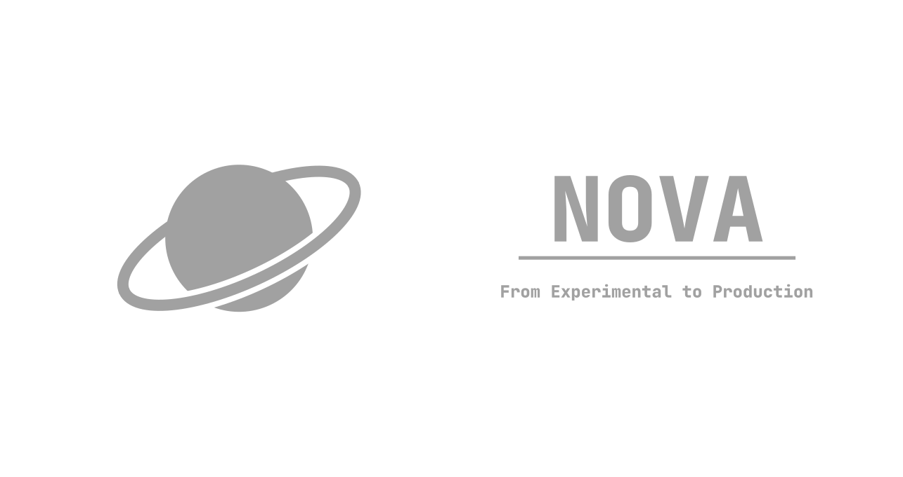

# Nova-Lang

<p align="center">
  
</p>

<div align="center">
  
  
  
  <br>
  
  
</div>

> **Notice:** Nova is currently in an early stage of development. Nova Software welcomes contributions from everyone interested in helping the project grow!

Nova also has its own [**documentation**](https://docs-nova.qussa.ru/), which we strongly recommend reading.

Nova Software actively strives to keep the documentation accurate and up to date. However, contributions are always welcome. You can find the documentation's source code in the [Nova-Book repository](https://github.com/Nova-Language-Software/Nova-Book), where you can submit your own improvements.

# A Few Words About the Language

> **Nova** is an experimental, compiled programming language with strict static typing.

Example code:

```nova
func main() -> void {
    print("Hello, world!")
}
```

Output:

```text
Hello, world!
```

# Nova SDK

> **Nova SDK** is a collection of tools required to develop applications using Nova.

The current SDK includes:

- `CLI` — a command-line tool for project management.
- `Nova compiler` — compiles Nova code into LLVM IR.
- `LLVM LLD` — the linker used to produce executable files.
- `Standard libraries` — a collection of libraries for common tasks.

Nova SDK is distributed through the following release channels:

- `Stable` — the stable release channel. Releases are planned approximately every 4–6 months.
- `Beta` — the beta release channel for users who want to try newer features without giving up all stability.
- `Nightly` — the latest development version, built daily at 00:00 UTC. Includes the newest features but may be unstable. Not recommended for production projects.

# Installation

1. Download the latest SDK installer from the `Stable` channel.
2. Run the installer.
3. Verify the installation by running the following command:

   ```bash
   nova --v
   ```

4. You're ready to go!

> **Encountered a problem?** Check our documentation first. If it doesn't help, [open an issue on GitHub](https://github.com/Nova-Language-Software/Nova-Lang/issues/new).